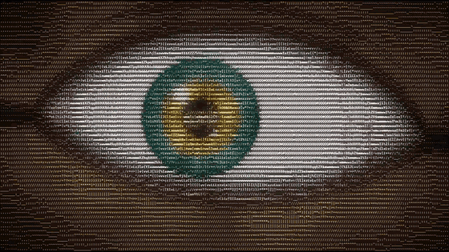
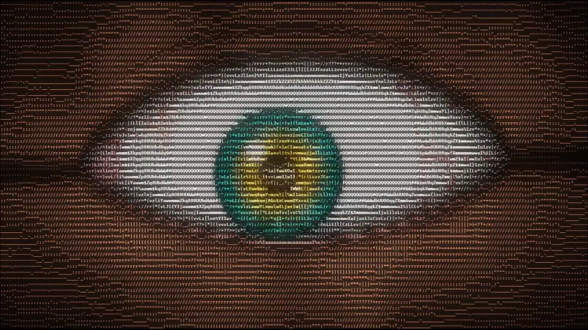
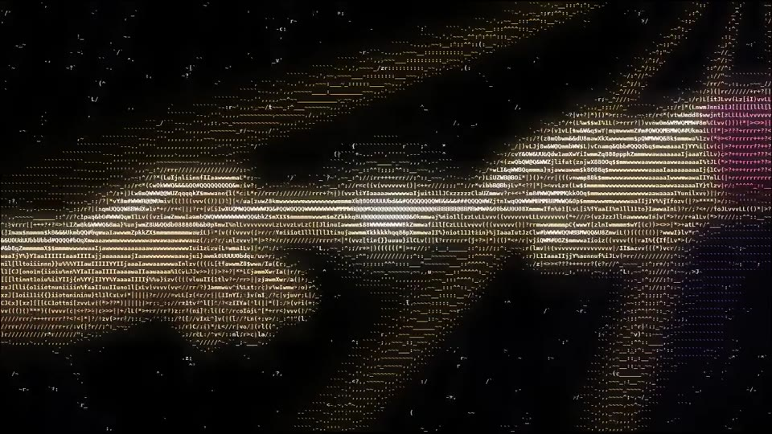
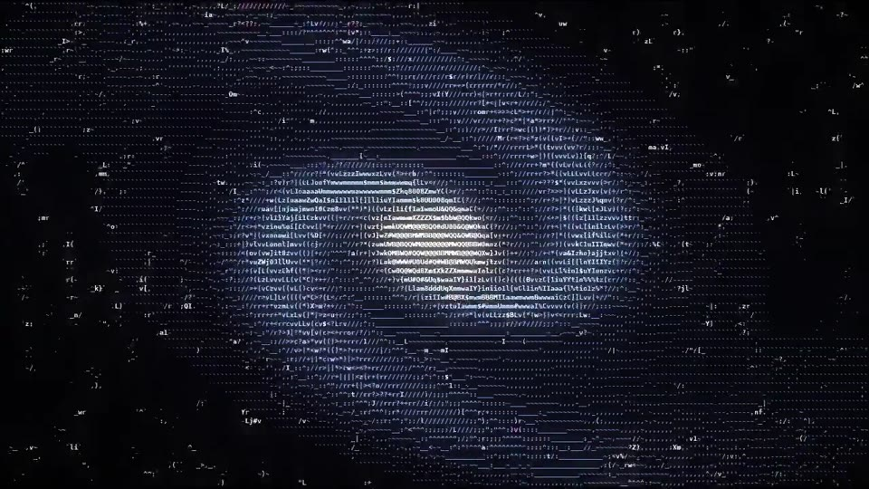
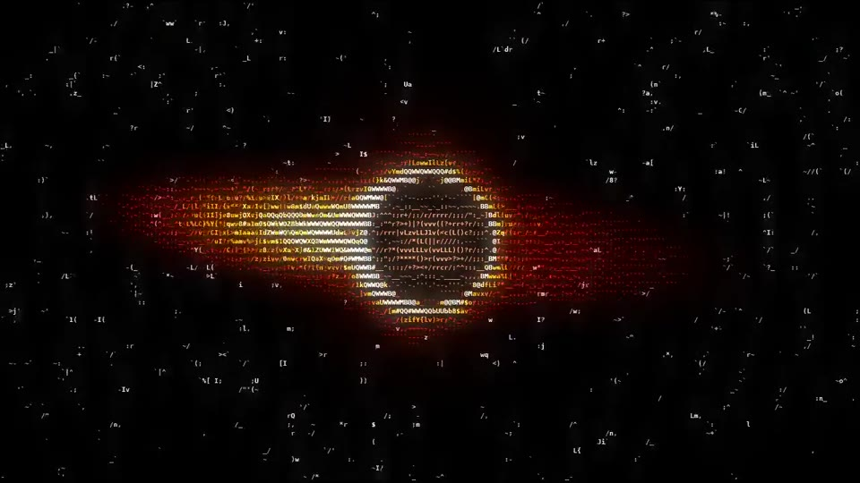

# 👁️ EYE OF CREATION

**An infinite, procedural ASCII zoom, written in Python.**

`EYE → pupil → CREATION → spark → BIG BANG → GALAXY → BLACK HOLE → horizon → EYE → …` forever.

<p align="center">
  
</p>

Everything is generated live with **numpy**: signed-distance fields, value noise and a little fake physics. Then it is drawn as coloured ASCII glyphs with bloom. There are **no images and no assets**. Even the two hands from Michelangelo's *Creation of Adam* are built from math.

| | |
|---|---|
|  |  |
|  |  |

## ✨ What's inside

- **The Eye**: a procedural iris with fibres and a collarette, veins, a wet rim, blinking and a breathing pupil. It **follows your mouse**.
- **Creation**: God's hand and Adam's hand, shaded from SDFs, with lightning crackling between the fingertips. **You steer God's hand with the mouse.**
- **Big Bang**: a hyperspace star tunnel that keeps accelerating.
- **Galaxy**: a tilted spiral with density-wave arms, dust lanes and pink star-forming knots.
- **Black Hole**: an Interstellar-style accretion disc with Doppler beaming, a lensed halo and a photon ring. Its event horizon hides… the eye again.
- Seamless portal transitions, camera roll, glitch cuts, bloom, 5 colour modes, and a CRT mode.

## 🚀 Run it

You need Python 3.9+.

```bash
pip install -r requirements.txt
python eye_of_creation.py
```

On **Windows** you can just double-click **`run.bat`**. It installs what's missing and starts the program. On macOS or Linux, use `./run.sh`.

Options:

```bash
python eye_of_creation.py --fullscreen
python eye_of_creation.py --size 720x1280   # portrait, for Reels / TikTok
python eye_of_creation.py --font 8          # more detail (needs a faster PC)
python eye_of_creation.py --font 13         # faster
```

> `pygame-ce` is used because it supports the newest Python versions. Plain `pygame` works too.

## 🎮 Controls

| Key | Action |
|---|---|
| Mouse | The eye follows you. In CREATION you steer God's hand. |
| Click | Blink |
| `SPACE` | Pause |
| `→` | Skip to the next world |
| `↑` / `↓` | Time speed |
| `+` / `-` | Glyph size (detail vs. speed) |
| `C` | Colour mode: Cosmic, Matrix, Amber, Inferno, Prism |
| `B` / `G` / `H` | Bloom / CRT scanlines / HUD |
| `S` | Screenshot |
| `R` | Record PNG frames at 30 fps (prints the ffmpeg command to make a video) |
| `F1` | Help |
| `ESC` | Quit |

## 🎬 Make a video

Press `R`, wait one full loop (about 1 minute), then press `R` again. The program prints the command to run:

```bash
ffmpeg -framerate 30 -i frames_XXXX/%05d.png -c:v libx264 -pix_fmt yuv420p -crf 17 eye_of_creation.mp4
```

## 🧠 How it works (short version)

1. Every world is a function `render(X, Y, t) → colour` evaluated on the grid of character cells, fully vectorised in numpy.
2. Each world has a **portal**: the pupil, the spark, the galaxy core, the event horizon. The camera zooms exponentially into it while the next world is rendered *inside* the portal. When the portal fills the screen, the worlds swap, and that is the infinite zoom.
3. Brightness picks a glyph whose ink coverage matches it, and colour tints it. Glyphs are composed with numpy and pygame blits, plus a cheap bloom pass.

## 📄 License

MIT. Use it, remix it, post it. A credit or a link back is appreciated 🙏

---

### 🇮🇷 فارسی

یه زوم بی‌نهایت با حروف ASCII که کامل با پایتون ساخته شده:
چشم ← مردمک ← دست خدا و آدم ← جرقه ← بیگ‌بنگ ← کهکشان ← سیاه‌چاله ← دوباره چشم.

**اجرا:**

```bash
pip install -r requirements.txt
python eye_of_creation.py
```

روی ویندوز فقط کافیه روی **`run.bat`** دابل‌کلیک کنی. برای راهنمای کلیدها هم توی برنامه `F1` رو بزن.
